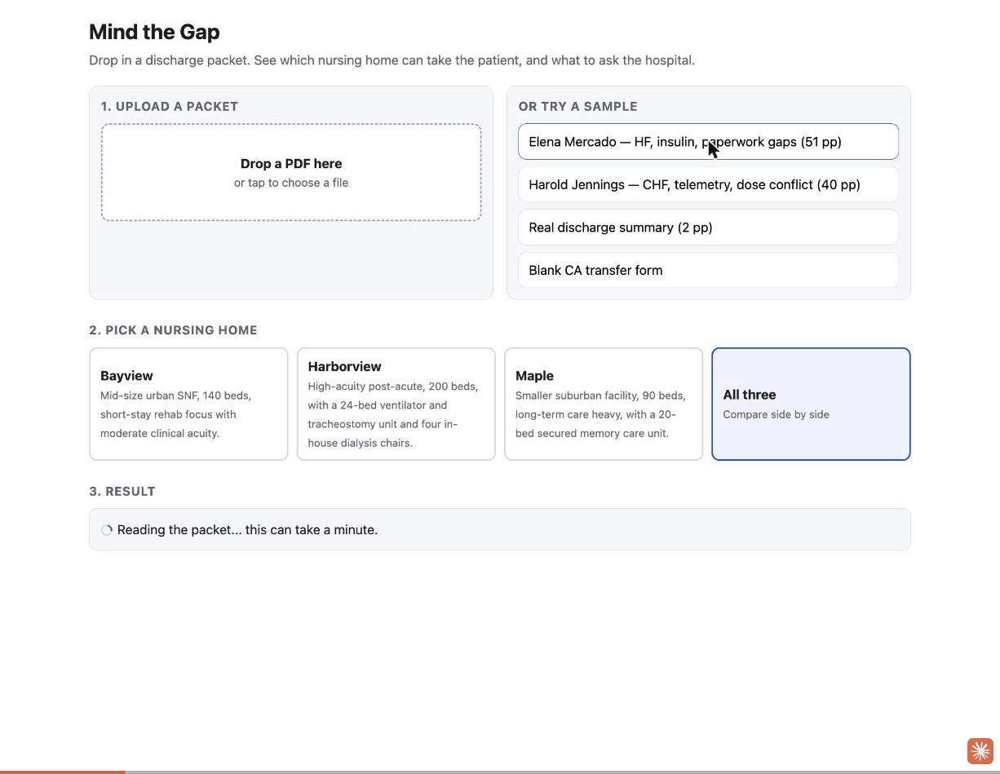

# mindthegap



Mind the Gap screens a roughly 60-page hospital-to-SNF referral packet (PDF) against the acceptance policies of three synthetic skilled nursing facilities: Bayview (A), Harborview (B) and Maple Grove (C). The output is a fixed-length, auditable checklist of 43 rules per facility, a verdict (accept, conditional accept, blocked, decline), and a worklist of items on a clock with computed resolve-by timestamps.

The design splits the work in two. An LLM extraction layer (stage 4) answers 43 facility-agnostic questions about the record once, citing the page and quote for each answer. A deterministic, pure-TypeScript engine then evaluates those answers against each facility's policy and tonight's capacity. The LLM never decides admissibility; the engine does. The source of truth for the rules is [docs/facility-acceptance-spec.md](docs/facility-acceptance-spec.md).

> **PHI WARNING. Never commit patient packets.** `samples/` and `data/` are gitignored; keep every packet and parse result inside them. Using this with real patient data requires a HIPAA Business Associate Agreement (BAA) with Anthropic. The facilities, formularies and thresholds in this repo are synthetic.

## Setup

```bash
npm install
cp .env.example .env     # ANTHROPIC_API_KEY, PORT, ANTHROPIC_MODEL (defaults to claude-fable-5-2)
npm run dev              # http://localhost:3000
npm test                 # engine + golden test (no network)
npm run build            # tsc -> dist/
npm run parse            # stub until stage 4
npm run make-sample              # synthetic Elena packet -> samples/synthetic-elena-packet.pdf
npm run make-sample -- harold    # synthetic Harold packet (paperwork complete) -> samples/synthetic-harold-packet.pdf
```

Node 20+. Stack: Hono, Zod, TypeScript (strict, ESM), Vitest.

## Demo UI

`GET /` serves the repo's built-in demo page (`public/`, plain HTML/CSS/JS, no build step): upload a PDF or click a sample packet, pick one of the three facilities (or all three), and read the result. `POST /api/parses/sample/:name` (`elena`, `harold`, `carepatron`, `cdph`) runs a PDF from `samples/` (generate the synthetic ones with `npm run make-sample`). With no `ANTHROPIC_API_KEY`, the two synthetic samples run the offline golden-fixture path and the record carries `"source": "fixture"` (live runs say `"live"`). This page is only a demo; the production UI is a separate workstream.

## API contract

All bodies are JSON unless noted. Stage 1 ships the facility endpoints; the parse endpoints return `501 {"error":"pipeline lands in a later stage"}` until stage 4 but their shape is fixed here so the UI can build against it.

| Method and path | Purpose |
|---|---|
| `GET /health` | `200 {"ok":true}` |
| `GET /api/facilities` | Array of facility profiles (see Policy and capacity data) |
| `GET /api/facilities/:id` | One profile (`A`, `B`, `C`) plus its current `capacity` snapshot |
| `PUT /api/facilities/:id/capacity` | Replace that facility's capacity snapshot. Body validated against the capacity schema (`src/policy/schema.ts`); `400` with `issues` on failure. Persists to `src/capacity/snapshot.json` |
| `POST /api/parses` | (future) `multipart/form-data`, field `packet` = PDF. `202 {"id": "...", "status": "processing"}` |
| `GET /api/parses/:id` | (future) Full result, shape below. While `status` is `processing`, only `id`, `status`, `progress` are present |
| `GET /api/parses/:id/summary` | (future) Compact row per facility for the list view |
| `GET /api/parses/:id/call-sheet` | Flat voice-agent call sheet, see "Follow-up asks and the call sheet" |
| `GET /api/parses/:id/document/:page` | (future) `{ "page": 12, "text": "..." }` for citation highlighting (1-based page) |

### Result shape (`GET /api/parses/:id`)

```jsonc
{
  "id": "string",
  "status": "processing | complete | failed",
  "createdAt": "ISO timestamp",
  "document": { "filename": "string", "pages": 60 },
  "extraction": {                      // what the LLM layer answered, input to the engine
    "answers": [{
      "ruleId": "PAY-01", "answered": true, "value": { "status": "pending" },
      "evidence": [{ "quote": "...", "claimedPage": 12, "page": 12, "startOffset": 0, "endOffset": 40, "sectionId": "...", "verified": true }],
      "contradictions": [{ "quoteA": "...", "pageA": 3, "quoteB": "...", "pageB": 41, "note": "..." }]
    }],
    "medications": [{ "name": "...", "dose": "...", "route": "...", "schedule": "...", "firstDoseDue": "ISO", "controlled": false, "hardCopyPresent": false, "correctionScale": false }],
    "timing": { "dischargeAt": "ISO", "arrivalAt": "ISO" },
    "patient": { "weightKg": 71.4, "targetUnit": "complex_medical", "medicaidPending": false, "tubeFed": false, "insulinRequired": true }
  },
  "facilities": {
    "A": {                              // same shape for "B" and "C"
      "facilityId": "A",
      "verdict": "accept | conditional_accept | blocked | decline",
      "blocking":    [Item], "conditional": [Item], "review": [Item],
      "firstDoseAtRisk": true,
      "checklist": [Item],              // always exactly 43, rule order, includes met and not_applicable
      "formularyReport": [{ "med": "...", "agent": "...", "status": "formulary | pa | nf | interchange | not_stocked | not_accepted | unmatched", "actions": ["..."], "leadHours": 72, "resolveBy": "ISO", "firstDoseAtRisk": true }],
      "beds": { "unit": "skilled_medical", "available": 1 }
    }
  },
  "criteriaView": {                     // 8 criteria, each with a per-facility rollup
    "regulatory_screens": { "A": { "worstState": "not_met", "items": [Item] }, "B": {}, "C": {} }
  }
}
```

An `Item` is one rule evaluated for one facility:

```jsonc
{
  "ruleId": "RX-06", "category": "RX", "criterion": "pharmacy_operations", "question": "...",
  "state": "met | not_met | unknown | contradictory | not_applicable",
  "decision": "block | conditional | review | null",   // null when met or not_applicable
  "windowHours": 12,                                   // conditional only
  "resolveBy": "ISO",                                  // conditional only: arrival + window (RX-02: earliest at-risk first dose)
  "resolvable": "sender | capability",                 // capability = facility cannot do it at any paperwork level
  "preArrival": false,
  "requirement": { },                                  // machine-readable params from rules.json
  "evidence": [], "contradictions": [],                // both passages surfaced for contradictory; never auto-resolved
  "detail": "string",                                  // engine explanation, optional
  "notes": "original policy cell text"
}
```

Verdict rollup: `decline` if any blocking item is `resolvable: capability`; `blocked` if any blocking item is `preArrival` (the sender must fix it before the patient travels); `conditional_accept` if blocking items remain that are cleared during the admission process, or any conditional items exist; `accept` otherwise. A rule that is `unknown` or `contradictory` is never treated as met.

## What matters most (headline)

The summary opens with a "What matters most" section: a 2-3 sentence patient snapshot, then per facility a verdict, one headline sentence and 3-6 numbered priorities (with due-by times; `tonight` items are styled loudest). The 43-row checklist and evidence stay below as the audit trail. The CLI table prints the same priorities.

- `priorities` (in `result.json`): deterministic ranking per facility from `src/engine/priority.ts`, `prioritize(facilityResult, extraction, now)`. Order: tonight (first doses at risk, conditionals resolving within 12h of `now`), pre-arrival blocks, capability blocks, other blocks, conditionals by soonest resolve-by, contradictions, review items. A `decline` facility leads with its capability blocks. Candidates are `{id, text, severity, tier, dueBy?}` where `id` is a rule id or a synthetic id (`CAP-BEDS`, `FORMULARY:<agent>`).
- `headline` (in `result.json`): `{ source, droppedUngrounded, patientSnapshot, perFacility: { A|B|C: { headline, topPriorities: [{ text, ruleIds, dueBy?, severity }] } } }`, from `src/pipeline/headline.ts`. One structured-output call per parse through the same `Llm` seam, model and env, with no PDF: the input is a compact JSON digest (patient facts, medications, per-facility verdict and the top 10 candidates with rule questions and evidence quotes).
- Grounding: every `topPriorities` entry must cite ids present in the candidates sent for that facility. Entries citing an unknown id (or none) are dropped and counted in `headline.droppedUngrounded`. `dueBy` is taken from the cited candidates, not from the model.
- Fallback: if the call fails, the reply is unusable or there is no key, the same shape is built deterministically from the candidates and `headline.source` is `"deterministic"` (otherwise `"model"`). A facility whose model entries were all dropped gets the deterministic entries. The pipeline never fails because of the headline call.

## Dose conflicts, packet gaps and follow-up asks

Three additive, facility-verdict-neutral features (none of them can change a verdict, blocking list or conditional list).

- **Medication reconciliation sweep.** The facts extraction call reconciles every discharge medication against the final 72 hours of notes, consults and orders and reports each divergence as `Med.doseChanges[]` (`listedDose`, `noteDose`, `noteContext?`, both verbatim quotes and pages; anchored by the pipeline with `verifiedList`/`verifiedNote`). The model does not decide which dose is right. `src/engine/medrec.ts` turns each into a facility-independent tier-1 priority `MEDREC:<agent>` (chip `CONFIRM DOSE`): "Torsemide dose conflict: discharge list says 40 mg, last progress note says 60 mg — confirm before first dose". Also in `result.medRec` and as a flag on the `pharmacy_operations` criteria cell (flags never feed `worstState`).
- **Packet-completeness checks.** `src/engine/packet-checks.ts` is a registry of `PacketCheck {id, appliesWhen, expectation, check, severity: "caution", gapText, followUpAsk}`. v1: `PKT-HF-WEIGHTS` (heart failure implies a daily-weights ORDER) and `PKT-HF-PLAN` (heart failure implies weight-gain escalation parameters). Inputs are `patient.diagnoses.heartFailure` and `Extraction.monitoringOrders {dailyWeightsOrdered, weightEscalationPlan, evidence[]}` (an order, not a narrative mention). Failures are `result.packetGaps: {id, text, followUpAsk, evidence?}[]` (also top-level `packetGaps` in `result.json`), shown as a "Packet gaps" list on every facility card (chip `PACKET GAP`) and as flags on the `monitoring_transitions` cell. Records without `monitoringOrders` never produce gaps. To add a check, append to `PACKET_CHECKS`.
- **Follow-up asks and the call sheet.** `followUpAsk` is a one-sentence question for the discharging hospital ("Fax the PASRR Level I determination"). It is set deterministically in `src/engine/phrase.ts` (`followUpAsk`, per rule family) on every blocking/conditional/review `Item`, copied to `PriorityCandidate` and `TopPriority`, and built by the MEDREC/PKT builders for their items. The model headline may rewrite `text`, but `followUpAsk` is always copied from the cited candidate (never model-written); a `MEDREC:` candidate the model omits is re-added. The HTML shows it as a small "Ask: ..." line.

`GET /api/parses/:id/call-sheet` (404 unknown parse, 409 until complete) returns the future voice agent's input, a flat array ordered tonight, block, capability, clock, caution, review:

```json
[
  { "itemId": "MEDREC:torsemide", "severity": "tonight", "followUpAsk": "Confirm current torsemide dose: discharge list 40 mg vs 17 Nov cardiology progress note 60 mg" },
  { "itemId": "PKT-HF-WEIGHTS", "severity": "caution", "followUpAsk": "Send the signed physician order for daily weights" },
  { "facilityId": "A", "itemId": "MON-03", "severity": "capability", "followUpAsk": "Ask the physician whether telemetry can be replaced with spot checks, or whether a facility with telemetry is needed" }
]
```

`facilityId` is omitted for facility-independent items (`MEDREC:*`, `PKT-*`), which are listed once. Records parsed before this feature have no asks and yield an empty or shorter list.

## Policy and capacity data

Policy changes about once a year; capacity changes every shift. They are separate files and the engine joins them at evaluation time.

| File | Contents |
|---|---|
| `src/policy/schema.ts` | Zod schemas and inferred types for everything below |
| `src/policy/facilities.json` | Facility profiles: units, formulary contract, pharmacy cutoff and delivery, emergency kit, weight limit, secured/vent units, dialysis chairs |
| `src/policy/rules.json` | The 43 rules. Per facility: `requirement`, `notMetDecision` and `windowHours`, `unknownDecision` and `unknownWindowHours`, `resolvable`, original cell text in `notes` |
| `src/policy/formulary.json` | 79 agents x 3 facilities with status, lead hours, payor PA, interchange target, conditions |
| `src/capacity/snapshot.json` | "Capacity as of 17 Nov 20:00": beds per unit, isolation rooms, staffing, sitters, therapy |
| `src/types.ts` | `Extraction` and `RuleAnswer`, the contract the stage 4 extraction layer must produce |

Edit capacity through `PUT /api/facilities/:id/capacity` or by hand. Policy edits are code changes (rebuild from the facility's own manual before any real use).

## Engine

`src/engine/` is pure (no I/O, no `Date.now()`; the clock is injected as `now`, used only when `timing.arrivalAt` is absent). `evaluateFacility(extraction, facilityId, policy, capacity, now)` returns the 43-item checklist; `screen(...)` in `verdict.ts` rolls up all three facilities plus `criteriaView`. RX-01 to RX-05 and INF-03 are computed from the medication list, formulary, lead times and capacity, not from LLM answers. A `patient` field that an `appliesWhen` predicate reads and that is `undefined` never satisfies it, so the extraction layer must populate `patient.*` (targetUnit, medicaidPending, tubeFed, insulinRequired); `isolationRequired` is derived from INF-01.

## Unknown-decision derivations

Default: `unknownDecision` equals `notMetDecision` when that is `conditional` or `review` (same window). For rules whose not-met decision is `block`, the default is `conditional` at 24h (assumption, spec silent), except the pinned cells below, where an unknown blocks.

Pinned to block on unknown (from "How to read" and the Elena Mercado narrative):
- PAY-01 at A, B, C: pending or missing authorization blocks.
- REG-01 at A, B, C: PASRR never mentioned blocks ("you cannot place a patient on an assumption").
- INF-01 at A, B, C: undocumented isolation/MDRO status blocks at all three (Bayview and Harborview not-met is conditional, so this is a deliberate divergence from the default).
- RX-06 at B: orders required before arrival for complex medical and vent admissions.
- MON-02 at C: glucose parameters required before admission.
- PAY-04 at C: responsible party required at signing.
- ACU-06 at C: not accepted at all; unknown also blocks (assumption extending the Elena case).

Pinned to conditional despite a stricter policy: REG-02 at B (not met = block, unknown = conditional 24h) per design note 1.

Assumptions (spec silent, conditional 24h on unknown):
- Unknown on any other not-met-is-block rule: PAY-02, PAY-05 (C), REG-03 (C), ACU-01/02/04/05/07/09, ACU-03 (C), SKN-03 (C), NUT-01 (C), MON-03 (A, C).
- Cells written "C" with no hours (ACU-01/02/04/05 at B, ACU-03 at A and B, ACU-07 at C, ACU-08 at B and C, INF-01 at A and B, MON-03 at B, RX-02 at A) default to a 24h window. RX-02 at A has none: its resolve-by is the earliest at-risk first dose.
- Vancomycin IV at A is "NF" without hours: 72h assumed. Harborview `nextDelivery` "06:00" and Bayview emergency kit `includes: []` are assumptions.

Verdict note: the spec shows Bayview as "conditional accept" with three blocking items, which the plain rule "any block means blocked" cannot produce. Cells carry `preArrival` (set where the spec says before arrival: RX-06 and REG-02 at B). `blocked` requires a `preArrival` block; other sender-side blocks are listed in `blocking` but cleared during admission, giving `conditional_accept`. A capacity blocker `CAP-BEDS` is added when the target unit has no bed tonight.
